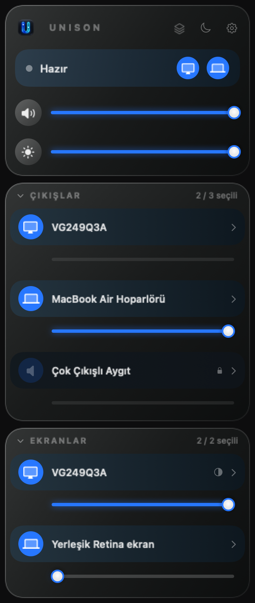

# Unison for macOS

**Sound and brightness control for your Mac.**

Unison is a free, open-source macOS menu bar app for HDMI volume control, external monitor brightness and simultaneous speaker output. If your Mac's HDMI volume slider is disabled, Unison can control the audio in software while keeping your speakers and displays in one panel.

[Install](#install) · [Setup guide](docs/INSTALL.md) · [MIT license](LICENSE)

<p align="center"></p>

## What you can do

- Play through selected speakers together and adjust each output separately.
- Control built-in and external display brightness, with software dimming when DDC is unavailable.
- Drag the sliders, scroll the mouse wheel over them, or swipe horizontally with two fingers.
- Adjust shared volume with media keys and macOS Control Center.
- Remember your devices and start at login. Audio stays on your Mac.

## Install

**Apple Silicon · macOS 14.4+ · Preview**

Download `Unison-Audio.pkg` from [Releases](https://github.com/fatihfatih0/unison/releases) when available. Open it, approve installation, then allow Accessibility and system audio capture when requested. The installer briefly restarts audio.

No release package yet? Download or clone the source, install Xcode 26 or newer and select its developer tools, then run:

```sh
./Scripts/build-installer.sh
open "$(cat build/latest-installer-path.txt)"
```

Open the **U** menu icon, select your speakers and displays, and play audio. The top sliders control selected devices together; each device has its own slider.

## Good to know

The app interface is currently Turkish. Tested on a MacBook Air M4 with an HDMI display; Intel support is unverified. External display controls depend on the monitor and connection. Software dimming does not change the physical backlight, and speaker latency may differ.

Keep the app running while its **Unison** virtual output is selected. Current builds are not Apple-notarized. See the [setup guide](docs/INSTALL.md) for permissions, troubleshooting and removal.

## Common questions

**Can I change HDMI monitor volume when macOS disables the volume controls?**

Yes. With system audio capture allowed, Unison processes the audio locally and applies software volume to the selected HDMI output. The included virtual output connects shared volume to macOS Control Center and volume keys.

**Can I play audio through my MacBook speakers and an HDMI monitor together?**

Yes. Select both physical outputs in the panel. Use the top volume slider for shared volume and each output's slider for its own level or mute. Different devices may have different playback latency.

**Does Unison change an external monitor's actual backlight brightness?**

On compatible monitors and connections, DDC changes hardware brightness. Otherwise, software dimming changes the displayed image while leaving the physical backlight unchanged. Built-in Mac display brightness is controlled separately.

## Contribute

Run `./Scripts/test.sh`. Bug reports and pull requests are welcome in English or Turkish. [Contributing](CONTRIBUTING.md) · [Development](docs/DEVELOPMENT.md) · [Publishing on GitHub](docs/PUBLISHING.md).

## License

[MIT](LICENSE). Built with m1ddc and libASPL; see [third-party notices](THIRD_PARTY_NOTICES.md). Visual direction inspired by [Tutti](https://github.com/BarryBarrywu/tutti); no Tutti code or assets are included.
